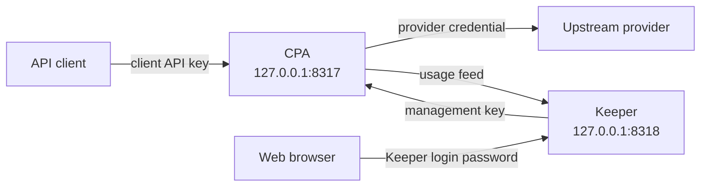

# CPA Stack

Run [CLIProxyAPI](https://github.com/router-for-me/CLIProxyAPI) (CPA) and [CPA Usage Keeper](https://github.com/Willxup/cpa-usage-keeper) locally with Docker Compose.

CPA sends client requests to an upstream provider. Keeper reads the usage feed from CPA and stores usage data.

## Prerequisites

- macOS with Node.js 24 LTS, version 24.12.0 or later.
- pnpm 12.4.1.
- Docker with Compose and a running Docker environment, such as [Colima](https://github.com/abiosoft/colima).
- Git and curl.

To install the Node.js and pnpm versions pinned in `mise.toml`, install and [activate mise](https://mise.jdx.dev/getting-started.html), then run from the repository root:

```sh
mise trust
mise install
```

Docker with Compose, Git, and curl remain system prerequisites.

## Quick start

Run the setup commands from the repository root.

1. Install dependencies:

   ```sh
   pnpm i
   ```

2. Create the local inputs and state directories.

   **Existing installation:** Keep your `.env` and `cpa/config.yaml.override` files. Do not copy the templates over them.

   ```sh
   cp .env.example .env
   cp cpa/config.yaml.override.example cpa/config.yaml.override
   mkdir -p cpa/auths cpa/logs cpa/plugins keeper
   ```

3. Configure credentials. Edit `.env` and replace each placeholder:

   ```dotenv
   CPA_MANAGEMENT_KEY='replace-with-a-strong-management-key'
   CPA_KEEPER_LOGIN_PASSWORD='replace-with-a-strong-login-password'
   CPA_CLIENT_API_KEY='replace-with-a-strong-client-api-key'
   ```

   Add provider credentials or OAuth records to `cpa/auths/`. Refer to the [CPA documentation](https://github.com/router-for-me/CLIProxyAPI) for authentication instructions.

4. Generate the effective config:

   ```sh
   pnpm generate
   ```

5. Start CPA and Keeper:

   ```sh
   pnpm bounce
   ```

Open [Keeper](http://127.0.0.1:8318). Sign in with the value of `CPA_KEEPER_LOGIN_PASSWORD`.

## Commands

Run these commands from the repository root.

| Command | Operation | Result |
| --- | --- | --- |
| `pnpm sync` | Release sync | Update image pins for available stable releases and the matching upstream baseline. |
| `pnpm generate` | Config generation | Apply the stack override to the upstream baseline. Write the effective config. |
| `pnpm bounce` | Stack bounce | Recreate CPA and Keeper with the current image pins and effective config. |

Run each operation explicitly. Release sync is optional for the first start.

After you change `.env` or the stack override, run `generate`, then `bounce`.

After release sync, review the changes. If the upstream baseline changed, run `generate`, then `bounce`.

**Bounce limit:** Success means that neither service was reported as exited immediately after recreation. It does not prove health or readiness.

## Architecture



CPA and Keeper use a private Compose network. Published ports use `127.0.0.1` and are available only on the local machine by default.

CPA also uses `127.0.0.1:1455` for the Codex OAuth callback.

## Repository files

```text
.
├── .env.example                     Template for local secrets
├── .env                             Local secrets
├── docker-compose.yml               Services, image pins, ports, mounts, and network
├── cpa/
│   ├── config.yaml.example          Upstream baseline
│   ├── config.yaml.override.example Stack override template
│   ├── config.yaml.override         Local stack override
│   ├── config.yaml                  Generated effective config
│   ├── config.yaml.backup           Previous effective config
│   ├── auths/                       Provider credentials and OAuth records
│   ├── logs/                        CPA logs
│   └── plugins/                     Optional plugins
└── keeper/                          Stored Keeper data
```

Edit `.env` and the stack override. Do not edit the effective config directly.

Git does not track local secrets, the stack override, generated config, or state directories. Keep local secrets private. Keep state directories when you update the stack.
