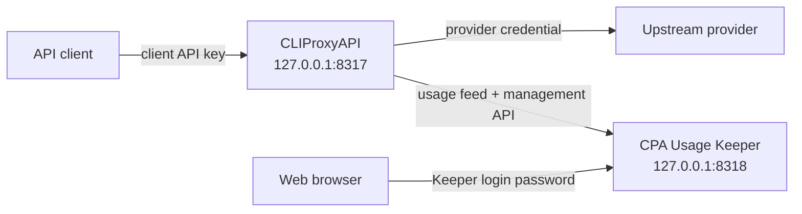

# CPA Stack

CPA Stack runs [CLIProxyAPI](https://github.com/router-for-me/CLIProxyAPI) (CPA) and [CPA Usage Keeper](https://github.com/Willxup/cpa-usage-keeper) locally with Docker Compose. CPA proxies authenticated client requests through configured provider credentials; Keeper records usage and provides a local dashboard. This repository contains deployment configuration and local state, not the upstream applications' source code.

## Architecture



Both services run on a private Compose network. Keeper reaches CPA through that network, while published ports bind to `127.0.0.1` and are available only on the local machine by default. CPA also publishes `127.0.0.1:1455` for its Codex OAuth callback.

## Prerequisites

The supported local setup uses macOS, [Homebrew](https://brew.sh/), and [Colima](https://github.com/abiosoft/colima). It requires Docker with Compose and [Mike Farah `yq`](https://github.com/mikefarah/yq); other programs named `yq` are incompatible.

```sh
brew install colima docker docker-compose yq
colima start
```

Run the remaining commands from the repository root.

## Repo anatomy

| Path | Role |
| --- | --- |
| `.env.example` | Template for local secrets and CPA client-key inputs. |
| `.env` | Ignored local secrets copied from `.env.example`. |
| `docker-compose.yml` | CPA and Keeper services, local ports, mounts, and network. |
| `cpa/config.yaml.example` | Tracked upstream CPA configuration baseline. |
| `cpa/config.yaml.override.example` | Template for stack-specific CPA policy. |
| `cpa/config.yaml.override` | Ignored operator-owned override copied from the template. |
| `cpa/config.yaml` | Ignored effective configuration generated by `./cpa-stack generate`; do not edit directly. |
| `cpa/auths/` | Provider credentials and OAuth records. |
| `cpa/logs/`, `cpa/plugins/` | Persisted CPA logs and optional plugins. |
| `keeper/` | Persisted Keeper data. |
| `cpa-stack` | Supported interface for operating the stack. |

Use the wrapper instead of running Docker Compose commands directly:

| Command | Purpose |
| --- | --- |
| `./cpa-stack sync` | Update the pinned stable CPA and Keeper releases and the matching upstream CPA configuration baseline. |
| `./cpa-stack generate` | Resolve local values and merge the stack override over the upstream baseline to create `cpa/config.yaml`. |
| `./cpa-stack restart` | Start or recreate CPA and Keeper using the current generated configuration and pinned images. |

Release synchronization is optional during initial setup. Run `generate` after changing `.env` or `cpa/config.yaml.override`, then run `restart` to apply the result.

## Quick start

1. Create the local configuration and state directories:

   ```sh
   cp .env.example .env
   cp cpa/config.yaml.override.example cpa/config.yaml.override
   mkdir -p cpa/auths cpa/logs cpa/plugins keeper
   ```

   On an existing installation, keep the existing `.env` and `cpa/config.yaml.override` instead of overwriting them.

2. Edit `.env` and replace every placeholder:

   ```dotenv
   CPA_MANAGEMENT_KEY='replace-with-a-strong-management-key'
   CPA_MANAGEMENT_KEY_HASHED='replace-with-the-hashed-management-key'
   CPA_KEEPER_LOGIN_PASSWORD='replace-with-a-strong-login-password'
   CPA_CLIENT_API_KEY='replace-with-a-strong-client-api-key'
   ```

   `CPA_MANAGEMENT_KEY_HASHED` is CPA's stored representation of the same management credential supplied to Keeper as `CPA_MANAGEMENT_KEY`. Keep `.env` private and follow the [upstream CPA documentation](https://github.com/router-for-me/CLIProxyAPI) for management-key and provider-authentication details.

3. Add provider credentials or OAuth records under `cpa/auths/`, then synchronize the release pins, generate the effective configuration, and start the stack:

   ```sh
   ./cpa-stack sync
   ./cpa-stack generate
   ./cpa-stack restart
   ```

4. Open <http://127.0.0.1:8318> and sign in with `CPA_KEEPER_LOGIN_PASSWORD`.
