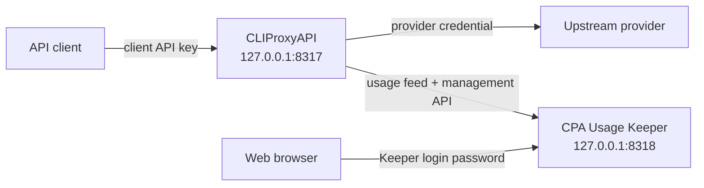

# CPA Stack

A local Docker Compose deployment of [CLIProxyAPI](https://github.com/router-for-me/CLIProxyAPI) (CPA) and [CPA Usage Keeper](https://github.com/Willxup/cpa-usage-keeper).

CPA accepts authenticated client requests and routes them through configured provider credentials. Keeper consumes CPA's usage feed, persists usage data in SQLite, and provides a local dashboard. This repository contains deployment configuration and local operational state; it does not contain the source code for either service.

## Architecture



Docker Compose runs both services on a private bridge network. Published host ports bind to `127.0.0.1`, so they are available only on the local Mac by default.

| Host address | Purpose |
| --- | --- |
| `http://127.0.0.1:8317` | CPA client API |
| `http://127.0.0.1:8318` | Keeper dashboard and API |
| `127.0.0.1:1455` | CPA Codex OAuth callback |

Keeper connects to CPA over the Compose network. CPA must therefore accept management requests from another container even though its host-published ports remain loopback-only.

## Prerequisites

The supported setup uses macOS, Homebrew, and Colima.

Install the required tools:

```sh
brew install colima docker docker-compose git
```

Start Colima and verify Docker Compose is available:

```sh
colima start
docker version
docker compose version
```

Run all remaining commands from the repository root.

## Quick start

### 1. Create local files and directories

```sh
cp .env.example .env
cp cpa/config.yaml.example cpa/config.yaml
mkdir -p cpa/auths cpa/logs cpa/plugins keeper
```

These local files and runtime directories are ignored by Git.

### 2. Configure Compose secrets

Edit `.env` and replace both placeholders:

```dotenv
CPA_MANAGEMENT_KEY='replace-with-a-strong-management-key'
CPA_KEEPER_LOGIN_PASSWORD='replace-with-a-strong-login-password'
```

Docker Compose automatically loads `.env` from the repository root. No `source` command is required.

- `CPA_MANAGEMENT_KEY` allows Keeper to call CPA's privileged management API.
- `CPA_KEEPER_LOGIN_PASSWORD` protects Keeper's web interface.

Keep the single quotes around each value so characters such as `$` remain literal during Compose interpolation. Shell environment variables take precedence over values in `.env`. Do not commit `.env` or share rendered Compose output, which can contain resolved secrets.

### 3. Configure CPA

Edit `cpa/config.yaml`. The copied template already contains the Docker-specific values required by this stack:

```yaml
host: ""
auth-dir: "/CLIProxyAPI/.cli-proxy-api"
usage-statistics-enabled: true

remote-management:
  allow-remote: true
  secret-key: ""
```

Set `remote-management.secret-key` to the same value as `CPA_MANAGEMENT_KEY` in `.env`. Also replace the example values under `api-keys` with the client API keys that should be allowed to call CPA.

The Docker-specific settings have distinct purposes:

- `host: ""` allows CPA to accept both published host traffic and Keeper's traffic over the Compose network.
- `auth-dir: "/CLIProxyAPI/.cli-proxy-api"` matches the container mount for provider credentials.
- `usage-statistics-enabled: true` enables the usage information Keeper consumes.
- `allow-remote: true` permits authenticated management calls from Keeper's container address. It does not expose CPA beyond the host bindings in `docker-compose.yml`.

For the full CPA configuration surface, use `cpa/config.yaml.example` and the [upstream CPA documentation](https://github.com/router-for-me/CLIProxyAPI).

### 4. Add provider credentials

CPA stores provider credentials under `cpa/auths/`. Existing CPA credential files can be copied into that directory.

Provider-specific OAuth and API-key acquisition flows belong to CPA and may change independently of this repository. Follow the [upstream CPA authentication instructions](https://github.com/router-for-me/CLIProxyAPI) rather than relying on commands copied into this README.

### 5. Start the stack

```sh
docker compose up -d
docker compose ps
```

Setup is complete when both services are running:

- `cli-proxy-api`
- `cpa-usage-keeper`

Open Keeper at <http://127.0.0.1:8318> and sign in with `CPA_KEEPER_LOGIN_PASSWORD`.

## Common operations

Show status:

```sh
docker compose ps
```

Follow all logs:

```sh
docker compose logs -f
```

Follow one service:

```sh
docker compose logs -f cli-proxy-api
docker compose logs -f cpa-usage-keeper
```

Start the stack or apply configuration changes:

```sh
docker compose up -d
```

Restart existing containers:

```sh
docker compose restart
```

Stop and remove containers without deleting bind-mounted data:

```sh
docker compose down
```

The services use `restart: unless-stopped`, so Docker restarts them after a crash or a Colima restart unless they were explicitly stopped.

## Applying secret changes

Compose interpolates `.env` when it creates a container. Editing `.env` does not update an already-created container.

After changing either secret, recreate Keeper:

```sh
docker compose up -d --force-recreate cpa-usage-keeper
```

If `CPA_MANAGEMENT_KEY` changed, update `remote-management.secret-key` in `cpa/config.yaml` to the same value and recreate both services:

```sh
docker compose up -d --force-recreate
```

Recreating containers does not delete bind-mounted state.

## Optional verification

Check CPA process readiness:

```sh
curl -fsS http://127.0.0.1:8317/healthz
```

Check Keeper process readiness:

```sh
curl -fsS http://127.0.0.1:8318/healthz
```

Check CPA's authenticated model listing with one of the client API keys from `cpa/config.yaml`:

```sh
curl -fsS \
  -H 'Authorization: Bearer YOUR_CLIENT_API_KEY' \
  http://127.0.0.1:8317/v1/models
```

These checks prove that the HTTP processes are responding. They do not by themselves prove that every provider credential works or that Keeper has ingested a usage event.

## Persistent local state

| Path | Contents |
| --- | --- |
| `cpa/config.yaml` | Local CPA configuration, client API keys, and management secret |
| `cpa/auths/` | Provider credentials and OAuth records |
| `cpa/logs/` | CPA file logs when enabled |
| `cpa/plugins/` | Optional persisted CPA plugins |
| `keeper/` | Keeper's SQLite database, logs, and internally managed data |

The `.env` file contains Compose secrets. All of these paths are local and ignored by Git; `.env.example` and `cpa/config.yaml.example` are the trackable templates.

Keeper may create internal backup files under its data directory, but this repository does not define or verify a disaster-recovery procedure.

## Updating

Both services intentionally track mutable `latest` image tags. Pulling can therefore introduce upstream application or database changes.

Review upstream release information when practical, then update with:

```sh
docker compose pull
docker compose up -d
docker compose ps
```

If the updated stack fails, inspect the service logs before making further changes:

```sh
docker compose logs --tail=200 cli-proxy-api
docker compose logs --tail=200 cpa-usage-keeper
```

## Troubleshooting

### Colima or Docker is unavailable

```sh
colima status
brew services list
docker version
```

Start Colima if necessary:

```sh
colima start
```

### Compose reports a missing variable

Confirm `.env` exists in the repository root and defines both required names:

```sh
test -f .env && echo '.env exists'
grep -q '^CPA_MANAGEMENT_KEY=' .env && echo 'CPA_MANAGEMENT_KEY present'
grep -q '^CPA_KEEPER_LOGIN_PASSWORD=' .env && echo 'CPA_KEEPER_LOGIN_PASSWORD present'
```

These checks print variable names only, not their values.

### A local port is already occupied

```sh
lsof -nP -iTCP:8317 -sTCP:LISTEN
lsof -nP -iTCP:8318 -sTCP:LISTEN
lsof -nP -iTCP:1455 -sTCP:LISTEN
```

The port mappings are intentionally explicit in `docker-compose.yml`. Change them only with an understanding of dependent URLs; the Codex OAuth callback expects host port `1455`.

### A container exits during startup

```sh
docker compose ps -a
docker compose logs --tail=200 cli-proxy-api
docker compose logs --tail=200 cpa-usage-keeper
```

Common causes include a missing `cpa/config.yaml`, invalid YAML, unresolved Compose secrets, or a port conflict.

### Keeper cannot reach CPA

Confirm both services share the Compose network and inspect their logs:

```sh
docker compose ps
docker compose logs --tail=200 cpa-usage-keeper
docker compose logs --tail=200 cli-proxy-api
```

In `cpa/config.yaml`, `host` must allow container-network traffic and `remote-management.allow-remote` must be `true`. The Keeper management key must match CPA's management secret.

For provider authentication, request routing, Keeper features, or plugin-specific failures, consult the upstream projects:

- [CLIProxyAPI](https://github.com/router-for-me/CLIProxyAPI)
- [CPA Usage Keeper](https://github.com/Willxup/cpa-usage-keeper)
