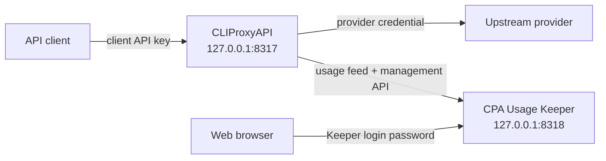

# CPA Stack

CPA Stack runs [CLIProxyAPI](https://github.com/router-for-me/CLIProxyAPI) (CPA) and [CPA Usage Keeper](https://github.com/Willxup/cpa-usage-keeper) locally with Docker Compose. CPA proxies authenticated client requests through configured provider credentials; Keeper records usage and provides a local dashboard. This repository contains deployment configuration and local state, not the upstream applications' source code.

## Architecture



Both services run on a private Compose network. Keeper reaches CPA through that network, while published ports bind to `127.0.0.1` and are available only on the local machine by default. CPA also publishes `127.0.0.1:1455` for its Codex OAuth callback.

## Prerequisites

The supported local setup uses macOS, [Homebrew](https://brew.sh/), and [Colima](https://github.com/abiosoft/colima). Install Node.js 24 LTS, version 24.12.0 or later, pnpm 12.4.1, Git, curl, and Docker with Compose. The CLI runs TypeScript directly with Node.js. It needs no build step, `tsx`, or `yq`.

```sh
brew install colima docker docker-compose
colima start
```

From the repository root, install the package dependencies:

```sh
pnpm install --frozen-lockfile
```

Use the pnpm scripts below from the repository root. To use `cpa-stack` from another directory, first make sure the directory reported by `pnpm bin -g` is on `PATH`. If it is not configured, run `pnpm setup` and open a new shell before continuing.

From the repository root, install a global link to this local clone:

```sh
pnpm add -g . --offline --ignore-scripts
```

The offline command requires the pinned pnpm version to be installed or cached already. Install the clone's dependencies first, as shown above. The command does not run lifecycle scripts.

After setup, `cpa-stack generate` is equivalent to `pnpm run generate`. The same applies to `sync` and `restart`.

The linked command uses the files in this clone, not the current directory. Keep the clone and its dependencies in place. Do not publish this package or use registry-backed `npx` execution. Native TypeScript execution inside `node_modules` is not a supported distribution method.

## Repo anatomy

| Path | Role |
| --- | --- |
| `.env.example` | Template for local secrets and CPA client-key inputs. |
| `.env` | Ignored local secrets copied from `.env.example`. |
| `docker-compose.yml` | CPA and Keeper services, local ports, mounts, and network. |
| `cpa/config.yaml.example` | Tracked upstream CPA configuration baseline. |
| `cpa/config.yaml.override.example` | Template for stack-specific CPA policy. |
| `cpa/config.yaml.override` | Ignored operator-owned override copied from the template. |
| `cpa/config.yaml` | Ignored effective configuration generated by `pnpm run generate`; do not edit directly. |
| `cpa/auths/` | Provider credentials and OAuth records. |
| `cpa/logs/`, `cpa/plugins/` | Persisted CPA logs and optional plugins. |
| `keeper/` | Persisted Keeper data. |
| `bin/cpa-stack.ts` | Native TypeScript entry point for the local `cpa-stack` package executable. |

Use these separate operations instead of running Docker Compose commands directly:

| Command | Purpose |
| --- | --- |
| `pnpm run sync` | Update the pinned stable CPA and Keeper releases and the matching upstream CPA configuration baseline. |
| `pnpm run generate` | Resolve local values and merge the stack override over the upstream baseline to create `cpa/config.yaml`. |
| `pnpm run restart` | Start or recreate CPA and Keeper using the current generated configuration and pinned images. |

Release sync is optional during initial setup. Run `generate` after changing `.env` or `cpa/config.yaml.override`, then run `restart` to apply the effective config. No operation runs another operation automatically. Stack restart checks only for an immediate service exit; success does not establish health or readiness.

## Quick start

1. Create the local configuration and state directories:

   ```sh
   cp .env.example .env
   cp cpa/config.yaml.override.example cpa/config.yaml.override
   mkdir -p cpa/auths cpa/logs cpa/plugins keeper
   ```

   On an existing installation, keep the existing `.env` and `cpa/config.yaml.override` instead of overwriting them.

2. Edit `.env` and replace every placeholder:

   ```dotenv
   CPA_MANAGEMENT_KEY='replace-with-a-strong-management-key'
   CPA_KEEPER_LOGIN_PASSWORD='replace-with-a-strong-login-password'
   CPA_CLIENT_API_KEY='replace-with-a-strong-client-api-key'
   ```

   Keep `.env` private and follow the [upstream CPA documentation](https://github.com/router-for-me/CLIProxyAPI) for management-key and provider-authentication details.

3. Add provider credentials or OAuth records under `cpa/auths/`, then synchronize the release pins, generate the effective configuration, and start the stack:

   ```sh
   pnpm run sync
   pnpm run generate
   pnpm run restart
   ```

4. Open <http://127.0.0.1:8318> and sign in with `CPA_KEEPER_LOGIN_PASSWORD`.

## Development checks

Use Node.js 24.12.0 or later and pnpm 12. The `packageManager` field pins pnpm to version 12.4.1. With pnpm installed, run `pnpm install --frozen-lockfile` to install development dependencies and the Husky Git hooks. Use `pnpm-lock.yaml` as the dependency lockfile; do not generate an npm lockfile.

| Command | Purpose |
| --- | --- |
| `pnpm run check` | Check formatting, lint, type-check, run unit tests, and run the Compose integration test. Stops at the first failure. |
| `pnpm run lint:fix` | Apply safe Oxlint fixes to code in `bin`, `src`, and `test`. |
| `pnpm run format` | Format TypeScript files in `bin`, `src`, and `test`, plus the root `package.json` and `tsconfig.json`. |

Oxfmt sorts imports and `package.json` keys. It uses semicolons, double quotes, and trailing commas wherever the syntax permits them. Its quote selection can use single quotes to avoid extra escaping.

The pre-commit hook runs lint-staged. It applies safe lint fixes, then formatting, to staged TypeScript files in those directories. It also formats the two selected JSON files. Upstream YAML, generated configuration, Markdown, and JSON compatibility records are outside the formatting scope.

The pre-push hook rejects staged or unstaged tracked changes. Commit or stash them before pushing. It then runs `pnpm run check` without applying fixes. Untracked files do not block the guard. Checks use the current working tree, not arbitrary refs supplied to `git push`; push the checked-out branch after committing all intended files.

The full suite needs pnpm 12, Git, `/bin/sh`, and the Docker CLI with Docker Compose. It does not need npm. The Compose tests validate synthetic configuration only: they do not require a running Docker daemon, start containers, or pull images. Command tests use controlled external commands. Package tests use temporary pnpm home, configuration, cache, and global installation directories. They do not change your global links. The tests use `pnpm with current` to avoid downloading a package manager into the isolated cache. They disable automatic dependency installation before scripts because the synthetic checkouts reuse installed dependencies. Neither the CLI nor the tests require `yq`, compilation, or `tsx`. Historical shell results remain in `test/fixtures/compatibility/`; the shell entry point and its test runners have been removed.

These are local checks, not remote CI enforcement. Hooks can be bypassed, and GitHub web edits do not run them. `pnpm run check` is also available for manual validation without hooks.
