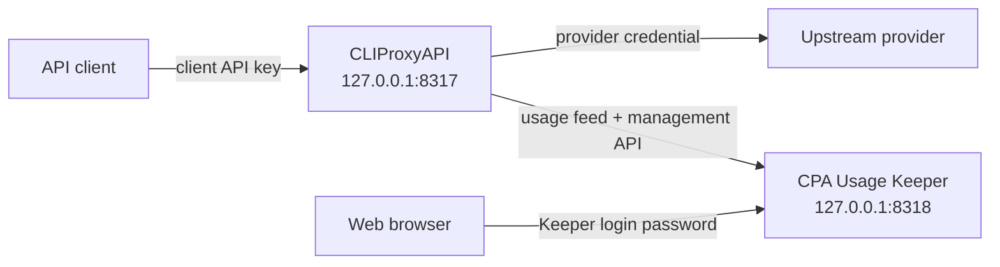

# CPA Stack

A local Docker Compose deployment of [CLIProxyAPI](https://github.com/router-for-me/CLIProxyAPI) (CPA) and [CPA Usage Keeper](https://github.com/Willxup/cpa-usage-keeper).

CPA accepts authenticated client requests and routes them through configured provider credentials. Keeper consumes CPA's usage feed, persists usage data in SQLite, and provides a local dashboard. This repository contains deployment configuration and local operational state; it does not contain the source code for either service.

## Architecture



Docker Compose runs both services on a private bridge network. Published host ports bind to `127.0.0.1`, so they are available only on the local Mac by default.

| Host address | Purpose |
| --- | --- |
| `http://127.0.0.1:8317` | CPA client API |
| `http://127.0.0.1:8318` | Keeper dashboard and API |
| `127.0.0.1:1455` | CPA Codex OAuth callback |

Keeper connects to CPA over the Compose network. CPA must therefore accept management requests from another container even though its host-published ports remain loopback-only.

## Prerequisites

The supported setup uses macOS, Homebrew, and Colima. Release synchronization requires `curl` and Git. Configuration generation and synchronization require [Mike Farah `yq`](https://github.com/mikefarah/yq); other programs named `yq` are incompatible.

Install the required tools:

```sh
brew install colima docker docker-compose git yq
```

Start Colima and verify the required commands are available:

```sh
colima start
docker version
docker compose version
curl --version
git --version
yq --version
```

Run all remaining commands from the repository root.

## Configuration layers

CPA configuration is assembled from local inputs and tracked templates:

| Path | Role |
| --- | --- |
| `cpa/config.yaml.example` | Tracked, byte-identical upstream baseline for the CPA version declared in `docker-compose.yml` |
| `cpa/config.yaml.override.example` | Tracked example of stack policy and unresolved environment references |
| `cpa/config.yaml.override` | Ignored, operator-owned local override copied from the example and customized as needed |
| `cpa/config.yaml` | Ignored, secret-bearing, generator-owned effective config |

`./cpa-stack generate` uses Docker Compose interpolation on the local override values, then recursively merges the override over the untouched baseline. Override scalars and sequences replace baseline values; mappings merge recursively. Do not edit `cpa/config.yaml` directly or print it to the terminal.

## Quick start

### 1. Create local inputs and directories

```sh
cp .env.example .env
cp cpa/config.yaml.override.example cpa/config.yaml.override
mkdir -p cpa/auths cpa/logs cpa/plugins keeper
```

The copied files and runtime directories are ignored by Git. On an existing installation, do not overwrite `.env` or `cpa/config.yaml.override`; keep the local values and policy already configured there.

### 2. Configure secrets

Edit `.env` and replace every placeholder:

```dotenv
CPA_MANAGEMENT_KEY='replace-with-a-strong-management-key'
CPA_KEEPER_LOGIN_PASSWORD='replace-with-a-strong-login-password'
CPA_CLIENT_API_KEY_1='replace-with-a-strong-client-api-key'
CPA_CLIENT_API_KEY_2='replace-with-a-different-strong-client-api-key'
CPA_CLIENT_API_KEY_3='replace-with-another-strong-client-api-key'
```

- `CPA_MANAGEMENT_KEY` allows Keeper to call CPA's privileged management API.
- `CPA_KEEPER_LOGIN_PASSWORD` protects Keeper's web interface.
- Each `CPA_CLIENT_API_KEY_*` value authorizes a client to call CPA. The override example contains one required environment reference for each key.

Both Docker Compose and `./cpa-stack generate` read `.env` as passive key-value data; no `source` command is required. Exported process variables take precedence over `.env` values. Keep the single quotes so characters such as `$` remain literal while `.env` is parsed. Do not commit `.env` or share rendered Compose output, which can contain resolved secrets.

### 3. Generate the effective CPA config

```sh
./cpa-stack generate
stat -f '%Lp %N' cpa/config.yaml
```

The mode check should report `600 cpa/config.yaml`. Generation does not contact the network, pull images, or touch containers. It accepts a dirty baseline and the ignored local override so configuration changes can be tested before the baseline is committed.

Before every successful replacement of an existing `cpa/config.yaml`, generation copies the existing file to `cpa/config.yaml.backup` with mode `0600`. Each run replaces the previous backup, so it always represents the effective configuration from immediately before the latest successful generation. The first generation does not create a backup when no effective config exists.

### 4. Add provider credentials

CPA stores provider credentials under `cpa/auths/`. Existing CPA credential files can be copied into that directory.

Provider-specific OAuth and API-key acquisition flows belong to CPA and may change independently of this repository. Follow the [upstream CPA authentication instructions](https://github.com/router-for-me/CLIProxyAPI) rather than relying on commands copied into this README.

### 5. Start the stack

```sh
docker compose up -d
docker compose ps
```

Setup is complete when both services are running:

- `cli-proxy-api`
- `cpa-usage-keeper`

Open Keeper at <http://127.0.0.1:8318> and sign in with `CPA_KEEPER_LOGIN_PASSWORD`.

## Common operations

Show status:

```sh
docker compose ps
```

Follow logs:

```sh
docker compose logs -f
docker compose logs -f cli-proxy-api
docker compose logs -f cpa-usage-keeper
```

Apply local configuration or secret changes:

```sh
./cpa-stack generate
./cpa-stack restart
```

Generation must succeed before containers are recreated. If it fails, the previous effective configuration remains in place. `./cpa-stack restart` requires an existing effective config, then force-recreates CPA and Keeper using the image versions and environment currently declared in the checkout. It does not synchronize releases or regenerate configuration.

The command fails if either service is already exited when Compose finishes recreating the stack. This is only an immediate state check, not a healthcheck or complete validation of CPA semantics; use the optional verification steps below after recreation.

Restart existing containers without applying changed Compose environment values:

```sh
docker compose restart
```

Stop and remove containers without deleting bind-mounted data:

```sh
docker compose down
```

The services use `restart: unless-stopped`, so Docker restarts them after a crash or a Colima restart unless they were explicitly stopped.

## Optional verification

Check CPA process readiness:

```sh
curl -fsS http://127.0.0.1:8317/healthz
```

Check Keeper process readiness:

```sh
curl -fsS http://127.0.0.1:8318/healthz
```

Check CPA's authenticated model listing with one of the client API keys from `.env`:

```sh
curl -fsS \
  -H 'Authorization: Bearer YOUR_CLIENT_API_KEY' \
  http://127.0.0.1:8317/v1/models
```

These checks prove that the HTTP processes are responding. They do not by themselves prove that every provider credential works or that Keeper has ingested a usage event. Generation validates interpolation and YAML assembly, not CPA's complete runtime semantics.

## Persistent local state

| Path | Contents |
| --- | --- |
| `.env` | Compose secrets and CPA client API keys |
| `cpa/config.yaml.override` | Operator-owned local CPA configuration overrides |
| `cpa/config.yaml` | Generated effective CPA configuration |
| `cpa/config.yaml.backup` | Previous effective CPA configuration, replaced on each successful generation |
| `cpa/auths/` | Provider credentials and OAuth records |
| `cpa/logs/` | CPA file logs when enabled |
| `cpa/plugins/` | Optional persisted CPA plugins |
| `keeper/` | Keeper's SQLite database, logs, and internally managed data |

These paths are local and ignored by Git. The tracked templates are `.env.example`, `cpa/config.yaml.example`, and `cpa/config.yaml.override.example`.

Keeper may create internal backup files under its data directory, but this repository does not define or verify a disaster-recovery procedure.

## Updating pinned releases

The Compose services use explicit stable release tags. The CPA image tag and `cpa/config.yaml.example` form one versioned unit: the upstream baseline must remain byte-identical to `config.example.yaml` from the exact CPA tag declared in Compose.

Synchronize the latest stable CPA and Keeper releases:

```sh
./cpa-stack sync
git diff -- docker-compose.yml cpa/config.yaml.example
```

Synchronization discovers each service release independently, ignores drafts and prereleases, and verifies each matching container image manifest without pulling image layers. CPA and Keeper advance independently: if one selected image is unavailable, synchronization keeps that service at its current version while still applying an available update for the other. An available CPA update also checks the exact-tag upstream baseline; when that baseline changes, synchronization prompts the operator to review the diff and regenerate the effective config. A CPA version change with a byte-identical baseline does not require regeneration. Synchronization refuses to run when either tracked artifact already has staged or unstaged changes. It does not generate the effective config, pull images, or touch running containers.

Review the upstream release notes and the focused Git diff before applying a synchronized release. Then generate the effective config and recreate the services as separate actions:

```sh
./cpa-stack generate
./cpa-stack restart
```

Restart may fetch a missing declared image through normal Compose behavior. It does not discover releases, perform a separate unconditional pull, or delete bind-mounted state. To reject a synchronized release before applying it, restore `docker-compose.yml` and `cpa/config.yaml.example`. If the updated stack fails, inspect the service logs before making further changes:

```sh
docker compose logs --tail=200 cli-proxy-api
docker compose logs --tail=200 cpa-usage-keeper
```

## Troubleshooting

### Configuration generation rejects `yq`

Confirm that the command is Mike Farah `yq`:

```sh
yq --version
```

Install or upgrade it with Homebrew if the output identifies another implementation:

```sh
brew install yq
```

### Generation reports a missing variable

Confirm `.env` exists and defines every required name without printing their values:

```sh
test -f .env && echo '.env exists'
for name in \
  CPA_MANAGEMENT_KEY \
  CPA_KEEPER_LOGIN_PASSWORD \
  CPA_CLIENT_API_KEY_1 \
  CPA_CLIENT_API_KEY_2 \
  CPA_CLIENT_API_KEY_3
do
  grep -q "^${name}=" .env && echo "$name present"
done
```

A failed generation leaves the previous `cpa/config.yaml` untouched.

### Colima or Docker is unavailable

```sh
colima status
brew services list
docker version
```

Start Colima if necessary:

```sh
colima start
```

### A local port is already occupied

```sh
lsof -nP -iTCP:8317 -sTCP:LISTEN
lsof -nP -iTCP:8318 -sTCP:LISTEN
lsof -nP -iTCP:1455 -sTCP:LISTEN
```

The port mappings are intentionally explicit in `docker-compose.yml`. Change them only with an understanding of dependent URLs; the Codex OAuth callback expects host port `1455`.

### A container exits during startup

```sh
docker compose ps -a
docker compose logs --tail=200 cli-proxy-api
docker compose logs --tail=200 cpa-usage-keeper
```

Common causes include a missing generated `cpa/config.yaml`, invalid CPA configuration, unresolved Compose secrets, or a port conflict.

### Keeper cannot reach CPA

Confirm both services share the Compose network and inspect their logs:

```sh
docker compose ps
docker compose logs --tail=200 cpa-usage-keeper
docker compose logs --tail=200 cli-proxy-api
```

The generated CPA config must allow container-network traffic and remote management. The Keeper management key must match CPA's management secret; both are generated from `CPA_MANAGEMENT_KEY`.

For provider authentication, request routing, Keeper features, or plugin-specific failures, consult the upstream projects:

- [CLIProxyAPI](https://github.com/router-for-me/CLIProxyAPI)
- [CPA Usage Keeper](https://github.com/Willxup/cpa-usage-keeper)
