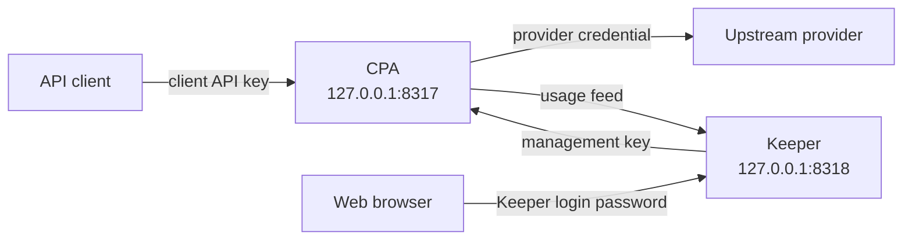

# CPA Stack

Run [CLIProxyAPI](https://github.com/router-for-me/CLIProxyAPI) (CPA) and [CPA Usage Keeper](https://github.com/Willxup/cpa-usage-keeper) locally with Docker Compose.

CPA sends client requests to an upstream provider. Keeper reads the usage feed from CPA and stores usage data.

## Prerequisites

- macOS with Node.js 24 LTS, version 24.12.0 or later.
- pnpm 12.4.1.
- Docker with Compose and a running Docker environment, such as [Colima](https://github.com/abiosoft/colima).
- Git and curl.

To install the Node.js and pnpm versions pinned in `mise.toml`, install and [activate mise](https://mise.jdx.dev/getting-started.html), then run from the repository root:

```sh
mise trust
mise install
```

Docker with Compose, Git, and curl remain system prerequisites.

## Quick start

Run the setup commands from the repository root.

1. Install dependencies:

   ```sh
   pnpm i
   ```

2. Create the local inputs and state directories.

   **Existing installation:** Keep your `.env` and `cpa/config.yaml.override` files. Do not copy the templates over them.

   ```sh
   cp .env.example .env
   cp cpa/config.yaml.override.example cpa/config.yaml.override
   mkdir -p cpa/auths cpa/logs cpa/plugins keeper
   ```

3. Configure credentials. Edit `.env` and replace each placeholder:

   ```dotenv
   CPA_MANAGEMENT_KEY='replace-with-a-strong-management-key'
   CPA_KEEPER_LOGIN_PASSWORD='replace-with-a-strong-login-password'
   CPA_CLIENT_API_KEY='replace-with-a-strong-client-api-key'
   CPA_CLIENT_API_KEY_CLAUDE_CODE='replace-with-a-strong-claude-code-client-api-key'
   CPA_CLIENT_API_KEY_CODEX='replace-with-a-strong-codex-client-api-key'
   CPA_CLIENT_API_KEY_OPENCODE='replace-with-a-strong-opencode-client-api-key'
   CPA_CLIENT_API_KEY_PI='replace-with-a-strong-pi-client-api-key'
   ```

   Add provider credentials or OAuth records to `cpa/auths/`. Refer to the [CPA documentation](https://github.com/router-for-me/CLIProxyAPI) for authentication instructions.

4. Generate the effective config:

   ```sh
   pnpm generate
   ```

5. Start CPA and Keeper:

   ```sh
   pnpm bounce
   ```

Open [Keeper](http://127.0.0.1:8318). Sign in with the value of `CPA_KEEPER_LOGIN_PASSWORD`.

## Commands

Run these commands from the repository root.

| Command | Operation | Result |
| --- | --- | --- |
| `pnpm sync` | Release sync | Update image pins for available stable releases and the matching upstream baseline. |
| `pnpm generate` | Config generation | Apply the stack override to the upstream baseline. Write the effective config. |
| `pnpm bounce` | Stack bounce | Recreate CPA and Keeper with the current image pins and effective config. |

Run each operation explicitly. Release sync is optional for the first start.

After you change `.env` or the stack override, run `generate`, then `bounce`.

After release sync, review the changes. If the upstream baseline changed, run `generate`, then `bounce`.

**Bounce limit:** Success means that neither service was reported as exited immediately after recreation. It does not prove health or readiness.

## Read a client API key

Use the quiet command form when you capture a key:

```sh
pnpm --silent run client-api-key
pnpm --silent run client-api-key claude-code
```

With no argument, the command reads `CPA_CLIENT_API_KEY`. A client name selects `CPA_CLIENT_API_KEY_<SUFFIX>`: lowercase letters become uppercase, and hyphens become underscores. For example, `claude-code` selects `CPA_CLIENT_API_KEY_CLAUDE_CODE` and `pi` selects `CPA_CLIENT_API_KEY_PI`. Names must contain lowercase ASCII letters or digits, with single hyphens between groups. Empty arguments and extra arguments are errors.

Add a variable such as `CPA_CLIENT_API_KEY_NEW_TOOL` to enable lookup with `new-tool`. Add its reference to `api-keys` in your local stack override to let CPA accept that key. The templates include the generic key and four client-specific keys. Existing installations can keep their generic-key configuration; add client-specific variables and references as needed.

The reader always uses this repository's `.env`, not the caller's `.env` or inherited environment values. It uses Node.js `.env` parsing: quotes and comments are supported, and the last duplicate assignment wins. Values are literal; variable references and shell commands are not expanded or executed. Use single-quoted literal keys so Compose and the reader agree. **Compose can still prefer inherited environment values.** The reader does not report CPA's effective runtime configuration.

Success writes only the key, with no trailing newline. An explicit client never falls back to the generic key. Missing or empty keys and unreadable files exit with status `1`; invalid arguments exit with status `2`. Errors go to stderr, without key values or partial stdout. Running the command directly displays the secret in your terminal.

### Use from another directory

Add this helper to your shell configuration. Adjust the repository path for your checkout:

```sh
cpa_client_api_key() {
    pnpm --dir "$HOME/repos/personal/cpa-stack" --silent run client-api-key "$@"
}
```

The calling shell must already have pnpm and compatible Node.js on `PATH`. The helper does not activate mise or install tools. It does not change the calling shell's directory.

Capture the key inside an agent launch function, and stop if lookup fails:

```sh
local client_api_key
client_api_key="$(cpa_client_api_key claude-code)" || return $?
# Pass "$client_api_key" to the agent's authentication environment variable.
```

After you edit the helper, open a new shell. Lookup does not generate configuration or start services; after changing a key, run `pnpm generate`, then `pnpm bounce` to apply it to CPA.

## Architecture



CPA and Keeper use a private Compose network. Published ports use `127.0.0.1` and are available only on the local machine by default.

CPA also uses `127.0.0.1:1455` for the Codex OAuth callback.

## Repository files

```text
.
├── .env.example                     Template for local secrets
├── .env                             Local secrets
├── docker-compose.yml               Services, image pins, ports, mounts, and network
├── cpa/
│   ├── config.yaml.example          Upstream baseline
│   ├── config.yaml.override.example Stack override template
│   ├── config.yaml.override         Local stack override
│   ├── config.yaml                  Generated effective config
│   ├── config.yaml.backup           Previous effective config
│   ├── auths/                       Provider credentials and OAuth records
│   ├── logs/                        CPA logs
│   └── plugins/                     Optional plugins
└── keeper/                          Stored Keeper data
```

Edit `.env` and the stack override. Do not edit the effective config directly.

Git does not track local secrets, the stack override, generated config, or state directories. Keep local secrets private. Keep state directories when you update the stack.
